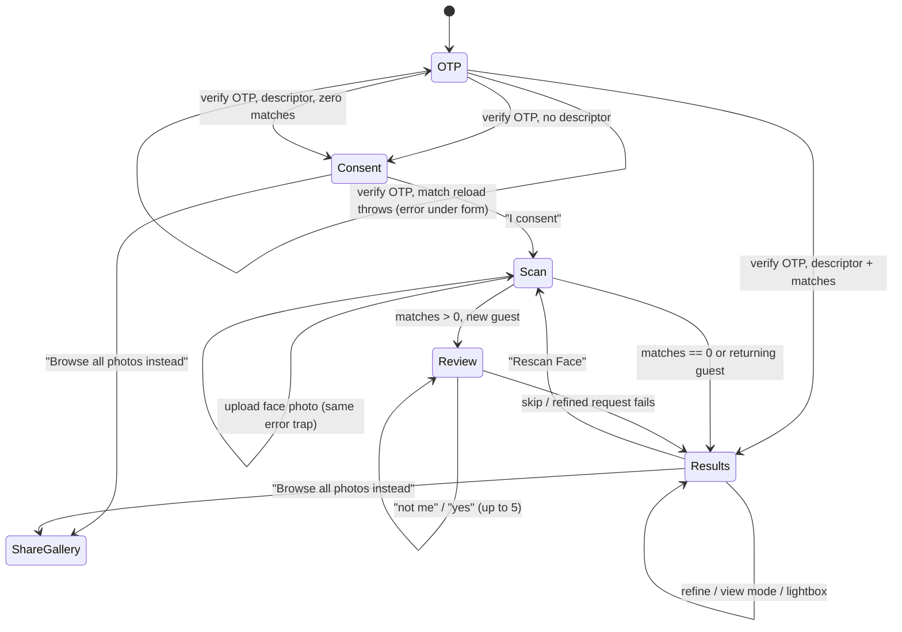
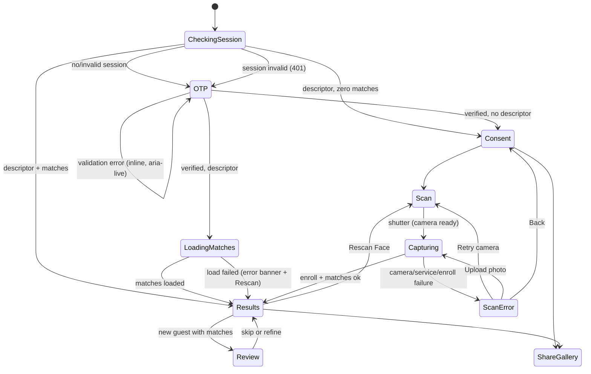

# Machine 01 — Guest face discovery

Owner: `src/app/share/[token]/guest/page.tsx`; servers: `src/app/api/guest/*`, `src/app/api/recognize/route.ts`.

Status: F-09/F-10/F-11 implemented (scan error card, enroll checks, results fallback). Full page reducer extraction deferred (ADR-010); the camera overlay is driven by `src/lib/guest-scan.ts`.

## As-is

Observed disagreements with intent:

- The error text is rendered in the page card (`guest/page.tsx:1500-1510`) while the scan step renders a `position:fixed` full-screen overlay (`:764`). Errors from `scanAndMatch` (`:361`) and `handleUploadSelection` (`:444`) are invisible.
- `scanAndMatch` stops the camera (`:308`) before the network work; on failure there is no control to restart it. Only browser Back escapes.
- `busy` is shared by OTP, scan, refine and polling; a failed request in one step can leave the next step's button disabled until the `finally` runs.
- Returning guests are excluded from Quick Review by `!isReturningGuest` (`:480`).

## To-be (implemented changes marked)

Transition table (delta only; all other rows unchanged):

| From | Event | Guard | Effect | To | Trigger |
|---|---|---|---|---|---|
| Capturing | enroll response !ok | — | set scan error, stop spinner | ScanError | server |
| Capturing | match load throws | — | set error banner, keep matches empty | ScanError / Results | server |
| ScanError | Retry camera | — | `startCamera()` | Scan | user |
| ScanError | Upload | — | open file picker | ScanError | user |
| ScanError | Back | — | stop camera | Consent | user |
| LoadingMatches | load throws | — | `setStep("results")` keeps error visible | Results | server |
| OTP | verify + has descriptor | load throws | error shown on Results, not OTP | Results | server |

Token cost/UX contract for the new error state:

| State | Sees | Can do | Disabled | Copy | Focus | Exit |
|---|---|---|---|---|---|---|
| ScanError | black camera view, error card | Retry camera, Upload photo, Back, Switch camera | shutter | “We couldn’t scan that. Check lighting and keep your face inside the oval.” | error card (announced) | 3 actions |

## Context and persistence

- Session: httpOnly `guest_session` JWT, 24 h (`src/lib/guest-auth.ts:5`), rotated on every OTP verify.
- Face descriptor: `Guest.faceDescriptor` JSON; either 128-float array, `{nativeMatches:[{photoId,score}]}` or legacy `{nativePhotoIds}`.
- No client persistence except the cookie; refresh re-runs `checkSession`.
- Timers/subscriptions: camera stream (cleaned in `stopCamera` and effect cleanup), keyboard listener while lightbox open.
