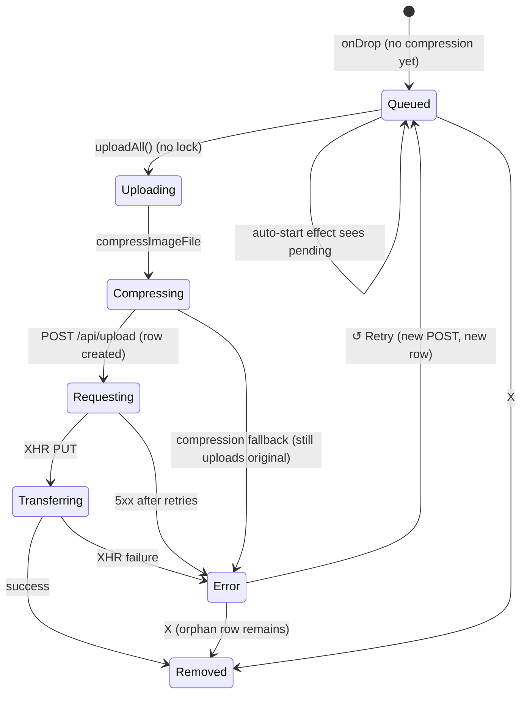
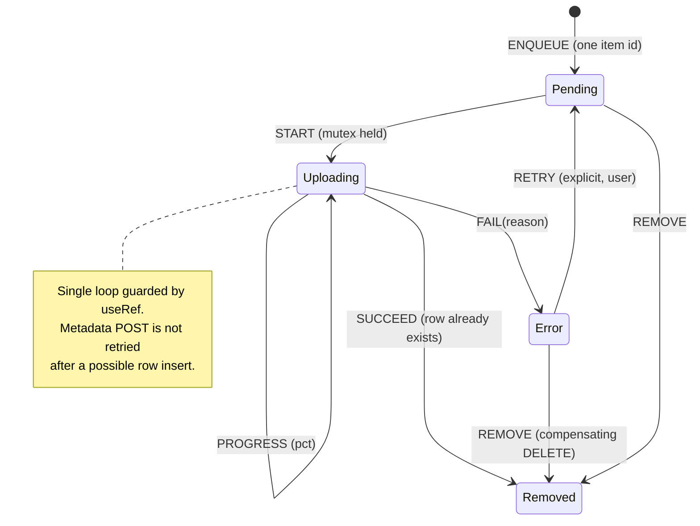

# Machine 02 — Album upload pipeline

Owner: `src/app/albums/[albumId]/page.tsx`, `src/lib/upload-queue.ts` (new), `/api/upload`, `/api/upload/local`.

Status: implemented (F-13/F-14/F-15). Queue state is `src/lib/upload-queue.ts`; auto-start re-arms when the loop drains; failed items require an explicit Retry; removal compensates the phantom row.

## As-is

Impossible states observed:

- Two loops can run at once (auto-effect + manual button in the same commit); both write `status:"uploading"` for the same item.
- `done` stays in the array until the next `setUploads`; UI filters it but `uploads.length` gates FaceProcessor.
- Error items are included in the next `uploadAll` run (`:338`), so dropping a new batch silently retries all failures.
- A DB row exists while the item is `error` or removed; retry creates a second row.

## To-be

Transition table:

| From | Event | Guard | Action | To | Trigger |
|---|---|---|---|---|---|
| — | ENQUEUE | queued path has ceremonyId | push item | Pending | user drop |
| Pending | START | loop lock acquired | compress, POST, PUT | Uploading | effect/user |
| Uploading | PROGRESS | pct 0–100 | update progress | Uploading | XHR |
| Uploading | SUCCEED | — | remove item, refresh album | Removed | XHR |
| Uploading | FAIL | — | keep `remotePhotoId`, set error | Error | XHR/server |
| Error | RETRY | — | dispatch RETRY | Pending | user |
| Error | REMOVE | — | DELETE `/api/photos/:id` best-effort | Removed | user |
| Pending | START | `!ceremonyId` | FAIL(“No ceremony”) | Error | effect |
| Uploading | START | lock held | ignore | Uploading | concurrent click |

UI contract:

| State | Sees | Can do | Disabled | Copy |
|---|---|---|---|---|
| Pending | filename, size, folder badge | remove | — | “PENDING” |
| Uploading | progress bar + % | nothing | remove | “Uploading…” |
| Error | reason | Retry, remove | — | reason + “Retry” |
| Empty | nothing | — | — | queue hidden |

## Context and persistence

- In-memory only; a refresh loses the queue. Server rows persist; a phantom row (tab closed mid-upload) is the residual risk.
- `File` handles stay in memory until removal; previews are not created (deliberate memory fix).
- Effects: auto-start on pending; FaceProcessor gated on `!isUploading && uploads.length === 0`.
