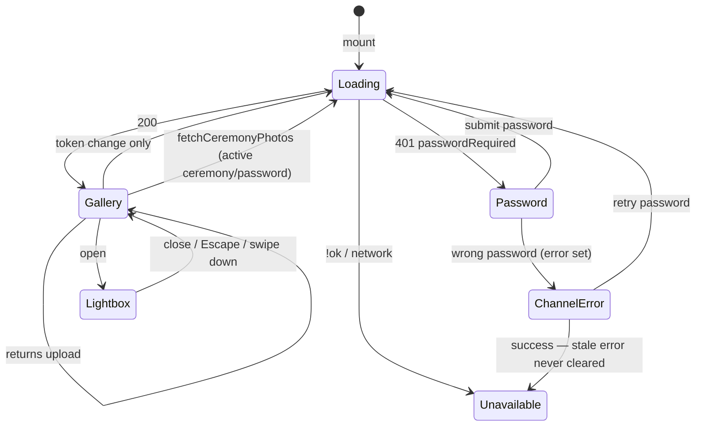
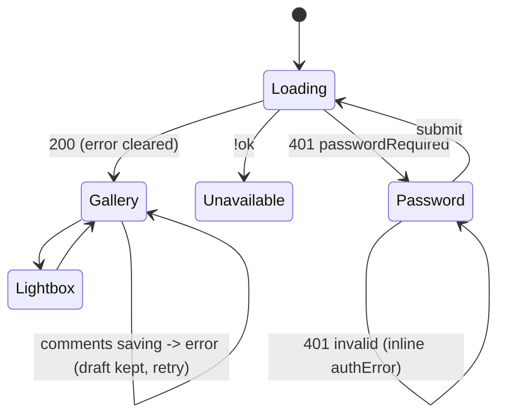

# Machine 03 — Share gallery access, selection and notes

Owner: `src/app/share/[token]/page.tsx`; servers: `/api/share/[token]`, `/api/share/[token]/ceremonies/:id/photos`, `/api/share/[token]/select`, `/api/share/[token]/download`, `/api/photos/:id`, `/api/comments`.

Status: implemented (F-01…F-05). Selection is versioned in `src/lib/selection-machine.ts`; Select All/Clear use the token-scoped batch endpoint (one request).

## As-is

Selection as-is: a plain `Set<string>`; the PATCH is fired inside the `setSelectedPhotos` updater (`page.tsx:170-181`), so React can double-invoke it. There is no failure handling and no version, so a late failure cannot be distinguished from a newer intent.

Comments as-is: fetch effect has no abort or photo identity check (`:497-507`); POST awaits the server and swallows failures; two Enter presses in the same tick both see `isSubmitting === false` (`:528-552`).

## To-be

Selection reducer (`src/lib/selection-machine.ts`):

| From | Event | Guard | To | Effect |
|---|---|---|---|---|
| idle | `toggle(id)` | not pending | pending(id, v+1) | optimistic add/remove; PATCH outside reducer |
| pending | `toggle(id)` | — | pending(id, v+1) | new intent wins; earlier response ignored |
| pending | `patch_ok(id, v)` | `v === current` | confirmed | clears pending |
| pending | `patch_fail(id, v)` | `v === current` | idle | revert to previous value + toast |
| pending | `patch_fail(id, old)` | `v < current` | pending | ignored |
| any | `replace(ids)` | — | idle | server reload |
| any | `clear` | — | idle | explicit clear (also PATCHes false per id) |

Comment state: `idle → saving → saved | error(draft)`; `AbortController` per photo, response ignored if `lightbox` is closed or moved; a `useRef` lock makes double submit impossible.

Download: `scope=finals` is resolved server-side; `scope=all`, `scope=ceremony` and explicit `photoIds` are unchanged. Password is sent in the form and verified server-side; expiry returns 410.

## UI contract

| State | Sees | Can do | Disabled | Copy |
|---|---|---|---|---|
| Loading | spinner | — | — | “Loading your album…” |
| Password | password card | submit, browse? no | submit while busy | “Protected Album” / “Incorrect password. Please try again.” |
| Unavailable | error card | — (no retry today) | — | album error message |
| Ceremony error | banner above grid | Retry | — | “Couldn’t load this ceremony.” |
| Selection saving | selected styling | toggle again | — | no spinner (optimistic) |
| Selection failed | reverted + toast | retry toggle | — | “Couldn’t save your selection.” |
| Notes saving | draft stays, send disabled | — | send | — |
| Notes failed | draft + error | retry | — | “Your note wasn’t saved.” |

## Persistence / server authority

- `selectedPhotos` rehydrates from `Photo.isSelected` on album load.
- Selection PATCH is public by design (`middleware.ts:44-48`), server writes DB; activity log on change.
- Comments are public/honour-system; server is authoritative on body/author.
