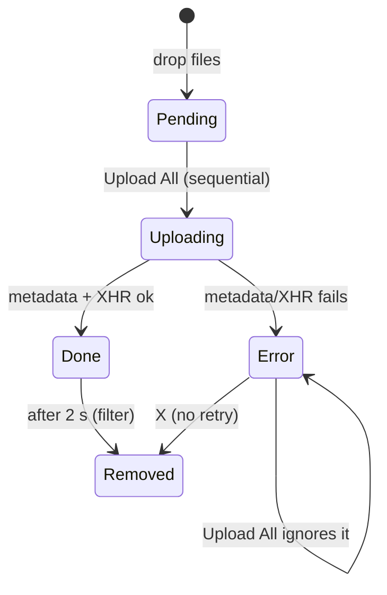
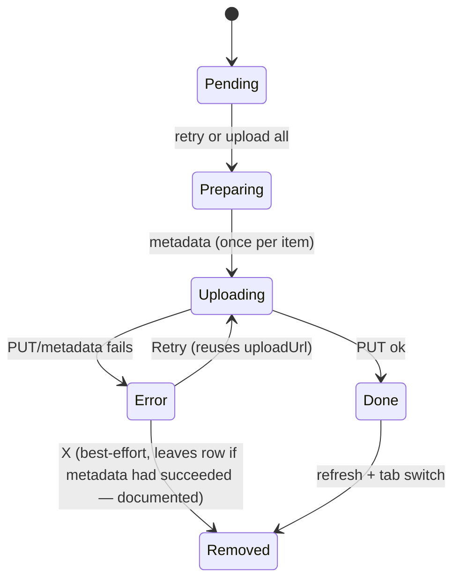

# Machine 04 — Share return uploads (photographer dropzone)

Owner: `src/app/share/[token]/page.tsx` (`returnUploads`, `uploadReturns`), `/api/share/[token]/upload`, local PUT.

## As-is

Observed:

- "Upload All" selects only `pending` (`page.tsx:386`); an error item can never be retried, only removed.
- Each attempt creates a new `Photo` row before the bytes (`api/share/[token]/upload/route.ts:70-80`); the queue does not keep the `photoId`, so a retry after a transient XHR failure duplicates the final.
- No password check on this endpoint (F-07).

## To-be

Transition table:

| From | Event | Guard | Action | To |
|---|---|---|---|---|
| — | drop | active ceremony | add items, no network | Pending |
| Pending | upload | — | POST metadata once, store `photoId`/`uploadUrl` | Preparing → Uploading |
| Uploading | PUT ok | — | mark Done | Done |
| Uploading | PUT fails | attempts < 3 | exponential retry same URL | Uploading |
| Uploading | PUT fails | attempts = 3 | store error + `uploadUrl` | Error |
| Error | Retry | has `uploadUrl` | resend PUT only (no duplicate row) | Uploading |
| Error | Retry | metadata failed | POST metadata again | Uploading |
| Done | refresh | — | `fetchAlbum()` + finals tab | Removed |

UI contract: queue shows per-item state, progress, Retry for errors, remove for everything except in-flight; “Upload All” disabled while uploading; failures keep the file and URL so retry is one click.

## Notes

- Password is required when the album is protected (ADR-004).
- Expiry is checked server-side before metadata creation.
- The existing per-item row index is replaced by stable item ids; a filtered list keyed by index can mis-associate progress when rows are removed.
