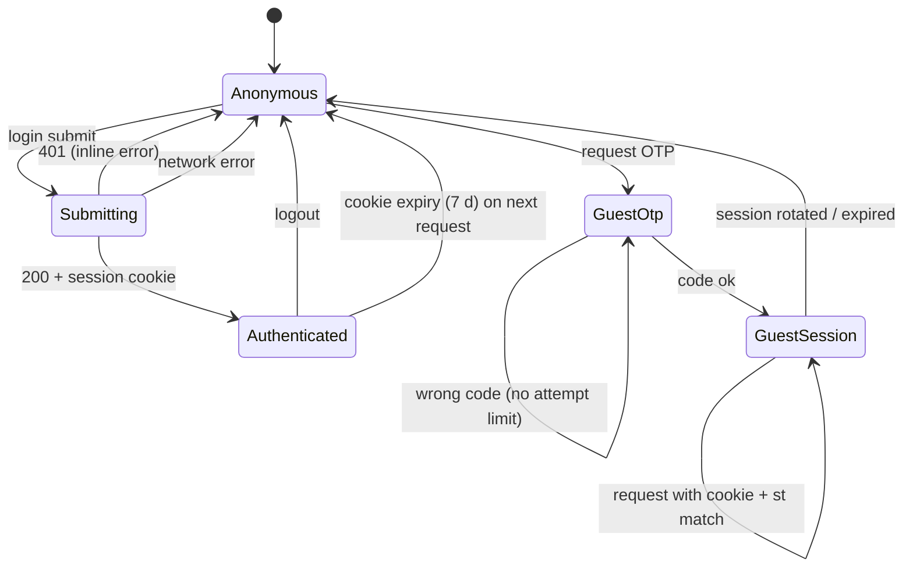
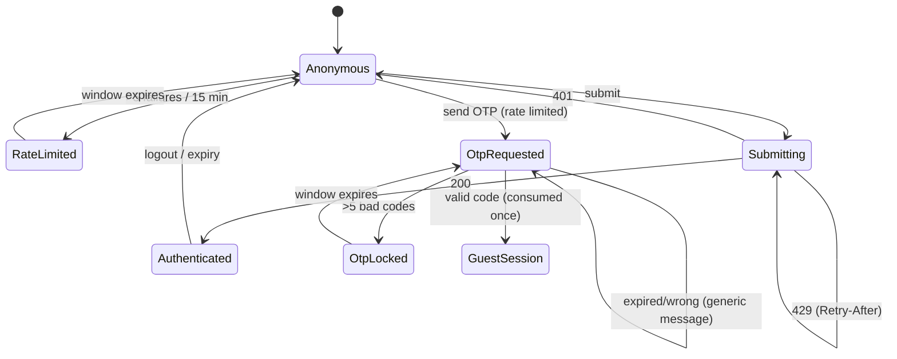

# Machine 05 — Authentication and sessions

Owners: `src/app/login/page.tsx`, `src/app/api/auth/*`, `src/middleware.ts`, `src/lib/guest-auth.ts`, guest OTP routes.

## As-is

Observed disagreements / defects:

- No rate limit on login or OTP; OTP is 6 digits valid 10 minutes with unlimited attempts (F-12, F-29).
- Admin middleware verifies signature/expiry but route authorization is prefix-based; `/api/photos` `PATCH` is public for every body field (L-08).
- Guest verify rotates `sessionToken` (good: old JWT invalid), but `Guest.email` is nullable while OTP lookup requires it; older rows can never re-auth.
- Login response sets `Secure` only when `NODE_ENV=production` (`auth/login/route.ts:54-60`); over the Cloudflare HTTPS tunnel this is correct, over plain LAN HTTP the cookie is not Secure.

## To-be

Transition table additions:

| Scope | Event | Limit | Response |
|---|---|---|---|
| login | failed credential | 5 / 15 min per IP+username | 429 + `Retry-After` |
| login | success | clears bucket | 200 |
| otp send | request | 3 / 10 min per album+email; 10 / 10 min per IP | 429 |
| otp verify | failure | 5 / 10 min per album+email; 20 / 10 min per IP | 429 |
| otp verify | success | clears identity bucket | 200 + rotated cookie |

Server authority: all checks server-side; no client state is trusted. `GUEST_OTP_BYPASS` remains an explicit deployment switch and is logged as a warning.

## UI contract

| State | Sees | Can do | Copy |
|---|---|---|---|
| Submitting | disabled button | — | “Signing in…” |
| Invalid | inline alert | retry | “Invalid credentials” |
| RateLimited | inline alert + countdown | wait | “Too many attempts. Try again in N minutes.” |
| OTP sent | OTP field | verify | “Passcode sent to your email.” |
| OTP locked | inline alert | wait / request new | “Too many incorrect codes. Request a new passcode later.” |
