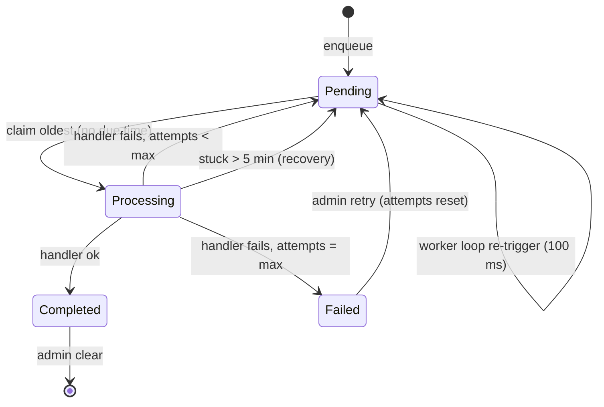
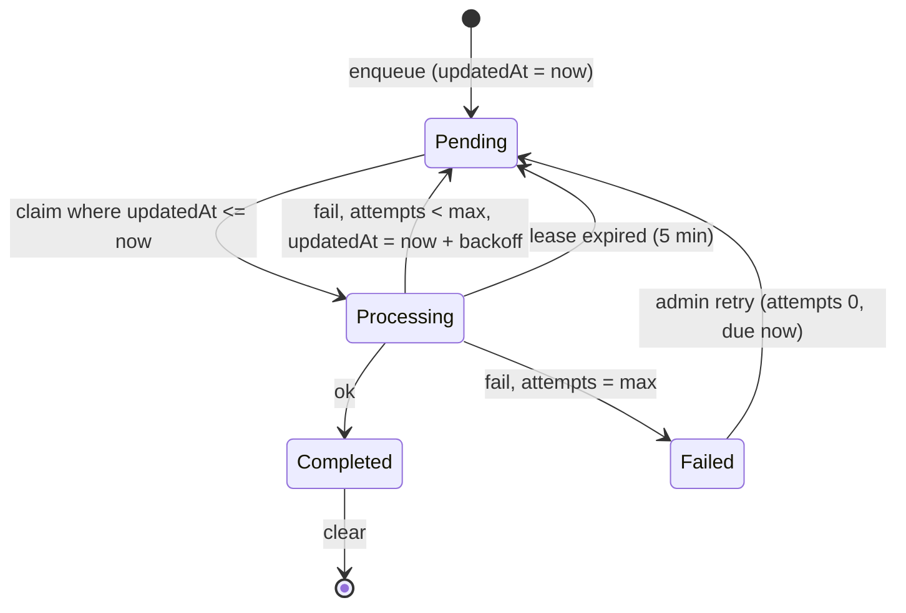

# Machine 06 — Background job queue

Owner: `src/lib/job-runner.ts`, `JobQueue` table, `/api/admin/jobs`, health page.

## As-is

Observed:

- Retry is immediate (`updatedAt = finishTime`, pending query has no time predicate) and the `finally` block re-triggers instantly → tight retry loop.
- Recovery resets `updatedAt` but not attempts; a handler that hangs forever still consumes attempts each reclaim, eventually failing. That part is sound.
- No lease owner: `isWorkerRunning` is process-local. With `instances > 1`, two processes claim the same job.
- `enqueueJob` swallows insert failure and still returns an id.
- Thumbnail job updates the photo row by `storageKey`; if the photo was deleted, the thumb file is left on disk.

## To-be

Transition table:

| From | Event | Guard | Effect | To |
|---|---|---|---|---|
| — | ENQUEUE | table exists | insert pending, due now | Pending |
| Pending | CLAIM | due (`updatedAt <= now`), no worker | attempts++, `updatedAt=now` | Processing |
| Processing | COMPLETE | — | status completed, clear error | Completed |
| Processing | FAIL | attempts < max | status pending, `updatedAt = now + min(30s·2^(n-1), 5m)` | Pending |
| Processing | FAIL | attempts ≥ max | status failed | Failed |
| Processing | LEASE_EXPIRED | `updatedAt < now-5m` | pending, due now | Pending |
| Failed | ADMIN_RETRY | — | attempts 0, due now | Pending |

Backoff helper is pure and tested (`tests/job-runner.test.ts`).

## UI / ops contract

| State | Health page | Admin action |
|---|---|---|
| Pending (due) | count | — |
| Pending (backoff) | counted as pending; recent job shows lastError | — |
| Processing | count | — |
| Failed | red count | Retry Failed |
| Completed | count | Clear Finished |

## Context

- Payload JSON: thumbnail `{resolvedPath, decodedKey}`, face index `{photoId, albumId, resolvedPath}`, cleanup `{filePaths}`.
- Persistence: SQLite; survives PM2 restart. `triggerWorker()` runs at module load and after enqueue.
- Concurrency 1 by design (phone). Documented in ADR-005.
