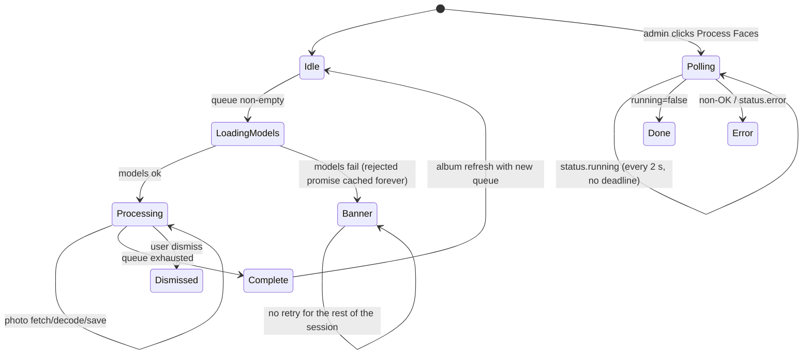
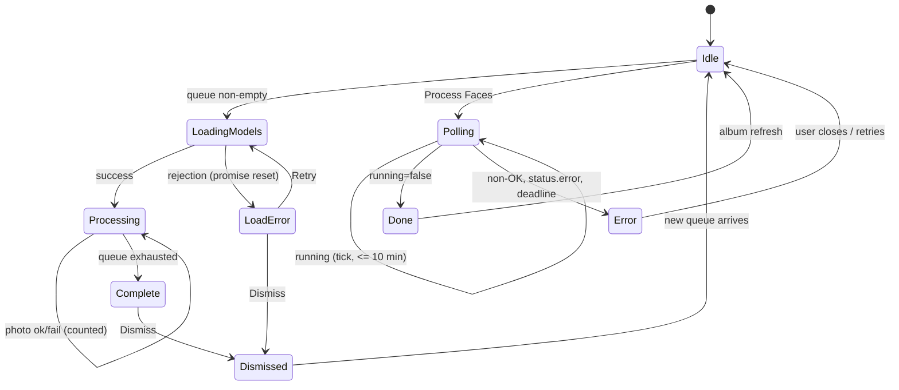

# Machine 07 — Face enrollment and indexing

Owners: `src/app/albums/[albumId]/FaceProcessor.tsx`, `/api/photos/:id/faces`, `/api/albums/:id/reprocess-faces`, `src/app/api/admin/enroll/[eventId]/route.ts`, `native-face-service/*`.

## As-is

Observed:

- `modelLoadPromise` caches rejection (`FaceProcessor.tsx:25-38`) so a transient CDN/404 failure disables face indexing until reload.
- Fatal load failure leaves the banner in “Processing faces (0/N)” (running false, `completeCount` null).
- Admin polling has no deadline and no unmount cancellation (`albums/[albumId]/page.tsx:608-641`). If the service keeps `running:true`, the button is disabled forever.
- Reprocess clears `photoFaces` and `face_embeddings` and sets `faceProcessed=false` in one transaction; good.
- Browser indexing and native indexing write different tables; the vector cache prefers 128-d `photoFaces` if any exist, otherwise 512-d `face_embeddings`.

## To-be

UI contract:

| State | Sees | Can do | Copy |
|---|---|---|---|
| Processing | fixed chip progress | Dismiss | “Processing faces (x/y)” |
| LoadError | chip with error | Retry, Dismiss | “Face models failed to load. Retry.” |
| Complete | chip summary | Dismiss | “Face processing complete (N photos, M failed)” |
| Polling | button spinner + status line | — (deadline abort) | “Processing 12 / 40 photos…” |
| PollError | status line in red | Process Faces again | server error message |

Persistence: descriptors in `PhotoFace`, native embeddings in `face_embeddings`, `Photo.faceProcessed` flag. Cache invalidation on faces POST and reprocess. No timers survive unmount after the fix.
