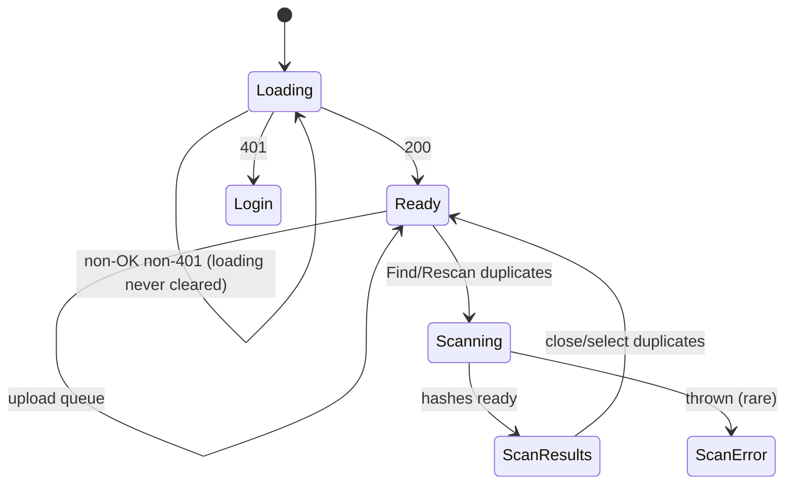
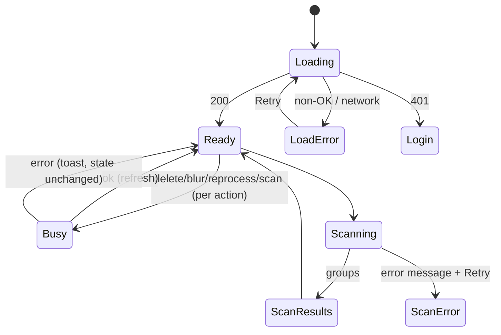

# Machine 08 — Album manager: load, destructive actions, dedup scan

Owner: `src/app/albums/[albumId]/page.tsx` plus photo/ceremony/album routes.

Status: F-16 implemented (load error + Retry). Per-action busy guards for destructive actions were not added; the report-only risk remains.

## As-is

Observed:

- `fetchAlbum` returns without clearing loading for 404/500 (`:131-158`), so “Album not found” and any retry UI are unreachable.
- Destructive actions have confirm dialogs but no pending/disabled state per target: two rapid confirms can issue two DELETEs (second 404 → toast), and the selection bar stays until refresh.
- `onDrop` can place folder photos into the wrong ceremony if auto-create failed (`:216-268`).
- Duplicate scan hashes thumbnails one by one; per-photo failures are skipped silently; a partial set shows as successful.

## To-be

Transition table (destructive subset):

| From | Event | Guard | Effect | To |
|---|---|---|---|---|
| Ready | DELETE_PHOTO_CONFIRMED | not busy | DELETE, refresh | Busy |
| Busy | ok | — | toast + refresh | Ready |
| Busy | fail | — | toast + keep row/selection | Ready |
| Ready | DELETE_ALBUM_CONFIRMED | not busy | DELETE, leave page | Leaving |
| Ready | SCAN_START | not busy | hash originals sequentially | Scanning |
| Scanning | DONE | — | open modal + persist hashes | ScanResults |
| Scanning | FAIL | — | inline error + Retry | ScanError |

UI contract:

| State | Sees | Can do | Disabled |
|---|---|---|---|
| Loading | centered spinner | — | — |
| LoadError | message + retry | Retry | — |
| Busy | action button spinner | other actions? no | the action’s controls |
| ScanError | inline red line under header | Find/Rescan | — |

## Server authority

All destructive calls are admin-guarded (`middleware.ts:31-58`); the client is not trusted for album ownership. File deletion precedes DB deletion; partial storage failures are silent (reported L-10).
