# Machine 09 — PWA install / offline lifecycle

Owners: `public/sw.js`, `src/components/PwaInstaller.tsx`, `src/app/manifest.ts`.

Status: F-24/F-25 implemented (per-entry pre-cache, auth/admin/guest API cache exclusions, v3 caches).

## As-is

```mermaid
stateDiagram-v2
    [*] --> Online: page load
    Online --> Installable: beforeinstallprompt
    Installable --> Online: dismissed (localStorage)
    Installable --> Online: accepted (prompt)
    Online --> Offline: browser offline event
    Offline --> Online: browser online event
    Online --> CachedShell: SW install (cache.addAll atomic; one bad URL -> zero entries)
    CachedShell --> CachedShell: cache-first files, network-first API (all GETs cached)
```

Observed:

- `STATIC_ASSETS` includes `/globals.css`, which has no route; `cache.addAll` is atomic, the rejection is swallowed, so **no** shell assets are pre-cached (`sw.js:7,11-25`).
- Every 200 GET `/api/*` is written to Cache Storage, including `/api/auth/me` and `/api/guest/my-photos` (face matches) — privacy and stale-session risk.
- Cache name bump is manual; old API cache is deleted on activate because it shares `CACHE_NAME` with the shell.

## To-be

```mermaid
stateDiagram-v2
    [*] --> Online
    Online --> Installable: beforeinstallprompt
    Installable --> Online: dismiss/accept
    Online --> Offline: offline event
    Offline --> Online: online event
    Online --> Precached: install (per-entry add, failures isolated)
    Precached --> Precached: files cache-first; share pages SWR
    Precached --> Precached: auth/admin/guest API never cached
```



Rules implemented:
- Pre-cache each URL with `cache.add(...).catch()`; one 404 cannot empty the cache.
- Network-first only for cacheable public API paths (`/api/share/`, `/api/comments/`, `/api/files/` is cache-first, `/api/photos/` not cached).
- Never cache `/api/auth/`, `/api/admin/`, `/api/guest/`, `/api/recognize`.
- Bump `CACHE_NAME`/`FILE_CACHE` version so deployed clients evict old entries on activate.

UI contract: install banner is dismissible permanently; offline badge is a top banner; no data-loss actions are offered while offline (uploads/downloads will fail with the browser’s network error).
