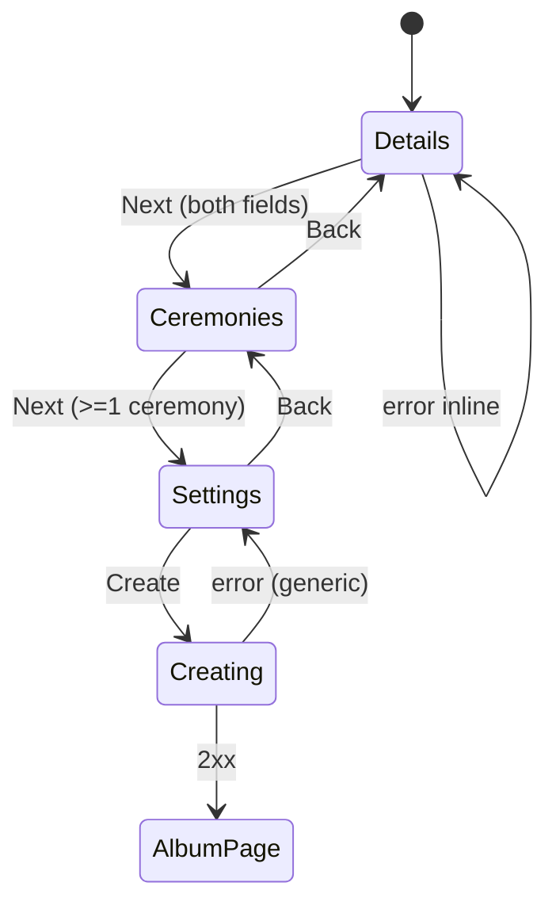
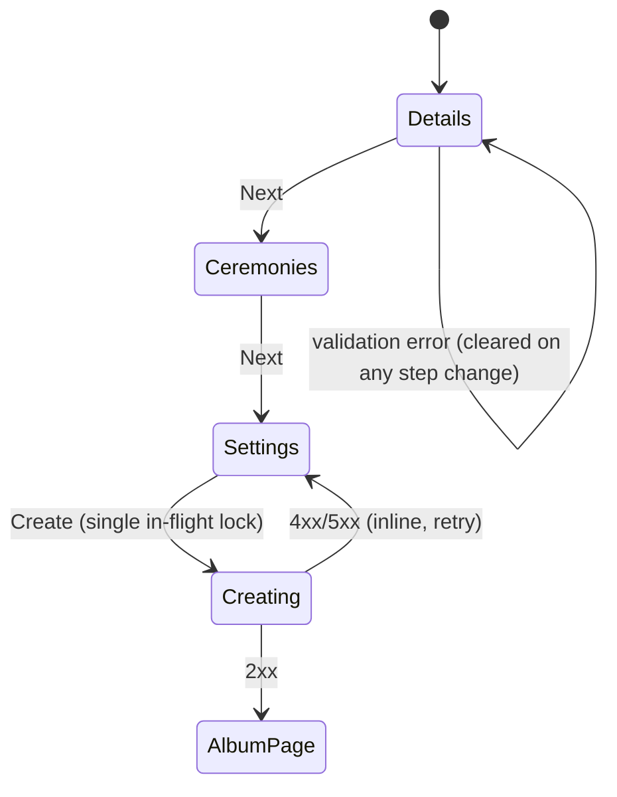

# Machine 10 — New-album wizard and expiry

Owner: `src/app/albums/new/page.tsx`, `/api/albums`.

Status: F-20 implemented (local end-of-day expiry, errors cleared on step change).

## As-is

Observed: `expiresAt` is `YYYY-MM-DD`, POSTed verbatim; `new Date()` makes it UTC midnight. `error` is not cleared when moving between steps, so a validation error from step 1 is still visible under step 3 until submit.

## To-be

Transition table:

| From | Event | Guard | Action | To |
|---|---|---|---|---|
| Details | NEXT | title && client | clear error | Ceremonies |
| Ceremonies | NEXT | ≥1 ceremony | clear error | Settings |
| Settings | CREATE | not loading | POST local end-of-day ISO | Creating |
| Creating | OK | — | `router.push` | AlbumPage |
| Creating | FAIL | — | error + unlock | Settings |

Invariant: stored `expiresAt` is the user’s local end of the selected day (ADR-008). Existing rows keep their old UTC-midnight value.

UI contract: error is a single line `role="alert"` near the action; Create is disabled while in flight with copy “Creating…”; Back is allowed while not creating.
