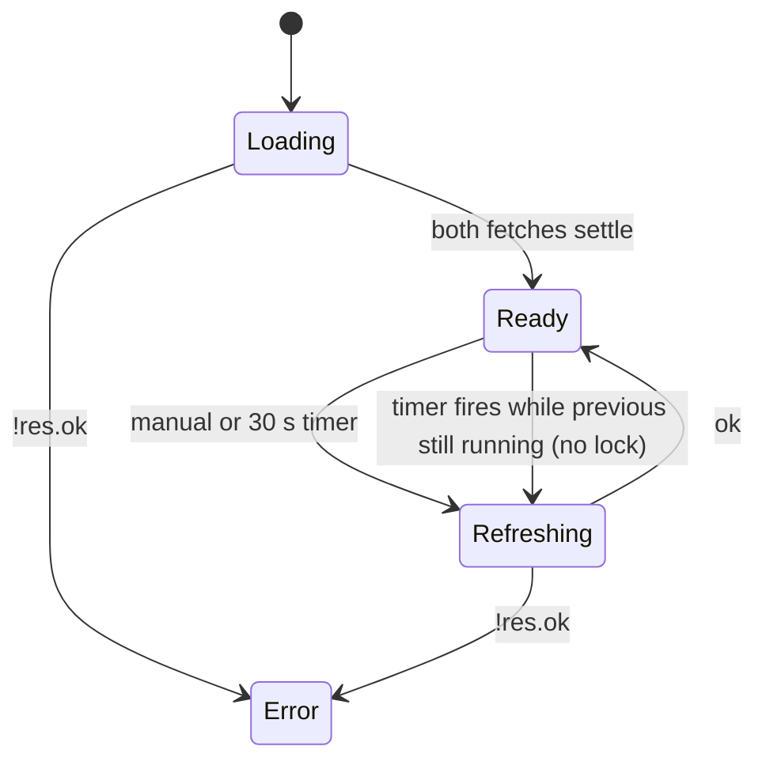
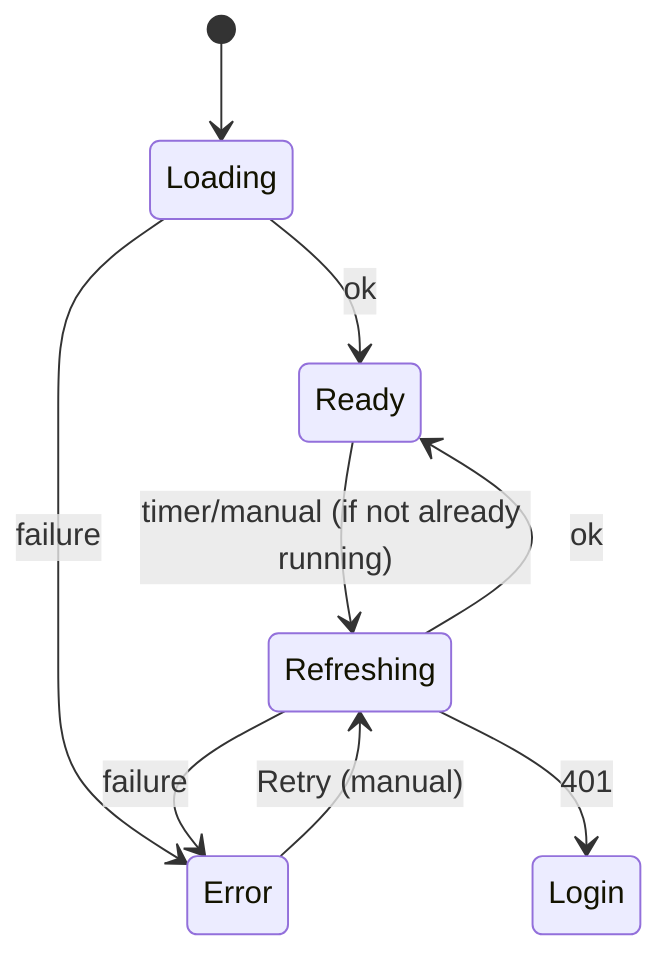

# Machine 11 — Health dashboard polling

Owner: `src/app/admin/health/page.tsx`, `/api/admin/health`, `/api/admin/jobs`.

Status: **report-only** (L-05). No code change in this branch; the poll lock/redirect design above is the recommended fix.

## As-is

Observed:

- `fetchHealth` has no in-flight guard; a slow phone health route (blocking `execSync` calls) can overlap with the next 30 s tick.
- 401 after session expiry shows a red banner but keeps polling forever; no redirect.
- `countdown` resets only on success; after an error it keeps counting down and looks like refreshes are happening.

## To-be

Transition table:

| From | Event | Guard | Effect | To |
|---|---|---|---|---|
| any | TICK | inFlight | ignore | unchanged |
| any | TICK | !inFlight | fetch health + jobs | Refreshing |
| Refreshing | OK | — | update data, lastRefresh, countdown | Ready |
| Refreshing | 401 | — | stop timer, redirect | Login |
| Refreshing | FAIL | — | error, keep last data | Error |

Ops note (reported, not changed): `/api/admin/health` calls `df`, `pm2 jlist` (twice) and `pgrep` synchronously; on a phone this blocks the event loop. The poll lock prevents client overlap but not server blocking (L-05).
